# 多分支神经网络的多模态退化预测

**Multi-Branch Multimodal Prognostics：融合信号图像、检修文本与数值历史，预测设备下一次检查时的退化程度。**

[English](README.en.md) · [Hugging Face 数据集](https://huggingface.co/datasets/GeorgeWJJ/steam-generator-multimodal-prognostics) · [完整实验与模型](https://github.com/13536309143/multi-branch-multimodal-prognostics/releases/tag/v1.0.0) · [方法细节](docs/methodology.md) · [验证说明](docs/validation.md)

   

本项目提供从多模态数据准备、模型训练、分组评估到权重推理和结果报告的完整研究流程。已发布实验包含 **2 套协议 × 10 种方法 × 5 折 × 5 个训练种子 = 500 项结果**，其中450项模型拟合、50项加权组合。

## 实验目的与功能

- 比较图像、文本、数值及其组合对下一次检查退化预测的贡献。
- 在同协议、同折和同种子下评估七种神经网络组合、加权集成、SVR和随机森林。
- 检查重复历史、文本重用、无信号图像和设备差异对泛化表现的影响。
- 提供训练集预处理、验证集模型选择、固定划分、完整性校验和可追溯结果。
- 支持Windows一键执行；输出最佳权重、逐样本预测、CSV指标、PNG/PDF图表和含全部50个目录轨迹的独立HTML报告。

## 方法原理

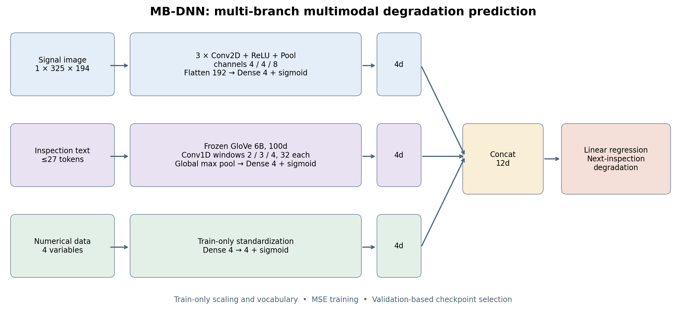

| 分支 | 输入 | 特征提取 | 输出 |
|---|---|---|---|
| 图像 `i` | `1×325×194` 灰度张量 | 三层卷积/ReLU/最大池化；通道4/4/8、卷积核4、池化4；展平192维后接sigmoid全连接层 | 4维 |
| 文本 `t` | 最多27词，GloVe 6B/100d | 冻结词向量；窗口2/3/4各32个Conv1D滤波器；全局最大池化、sigmoid全连接层 | 4维 |
| 数值 `n` | 四个训练集标准化变量 | 全连接 `4→4`、sigmoid | 4维 |
| 融合 | 所选分支特征 | 拼接后接线性标量回归层 | 下一次检查退化 |

图像使用明确的非对称SAME补零和向上取整池化；原像素除以255，不缩放、不裁剪坐标轴。文本小写化、保留词内撇号，超过27词报错；词表仅由训练数据建立。融合头本身没有非线性跨模态交互。

训练使用标准化目标MSE、Adam（lr=0.001）、batch=64、最多500轮；验证MSE早停patience=40、min_delta=1e-5，恢复最佳权重，评价前还原目标单位。具体选择见[方法说明](docs/methodology.md)。

## 数据准备

数据为Yang、Baraldi、Zio发布的蒸汽发生器**合成**多模态基准。本项目维护镜像、校验和评估元数据，不将上传者表述为原数据作者。

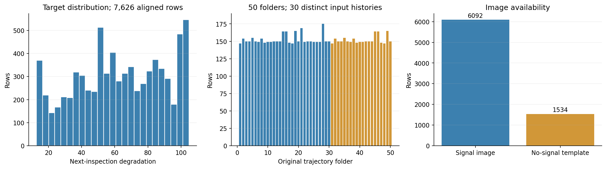

| 属性 | 数值 |
|---|---:|
| 对齐观测 / 原始目录 | 7,626 / 50 |
| 不同时间、文本、数值输入历史 | 30 |
| 信号 / 无信号模板图像 | 6,092 / 1,534 |
| 不同完整文本 / 最大分词长度 | 794 / 27 |
| 目标范围 | 12.75–104.83524 |

环境安装后，在项目根目录执行：

```powershell
.\.venv\Scripts\python.exe scripts\download_dataset.py
.\.venv\Scripts\python.exe scripts\download_dataset.py --verify-only
```

下载器固定 `dataset.json` 中的Hugging Face提交，检查ZIP哈希和全部 **7,977个原始文件**；已有数据校验通过后直接保留，不覆盖不匹配文件。

```text
Multimodal data for prognostics/
├── Readme.docx
├── 1/
│   ├── time.txt / nextinslevel.txt / workorder.txt
│   ├── Image/1.tiff, 2.tiff, ...
│   └── Numerical/
│       ├── Numberofchemicalcleaning.txt
│       ├── Numberofmechanicalcleaning.txt
│       ├── timefromlastrepair.txt
│       └── nextinstime.txt
└── ... 50/
```

序列第X行对应 `Image/X.tiff`。`nextinslevel.txt` 已是下一次检查退化，**不再平移标签**；`nextinstime.txt` 是已知的计划检查间隔，不是RUL。没有新文本时保留上一条记录；无信号图仍有坐标轴，默认保留。模型输入仅为图像、文本和四个数值变量，不使用设备/来源编号、绝对时间或标签作额外特征。

可选的数据浏览方式（需额外安装 `datasets`）：

```python
from datasets import load_dataset
data = load_dataset("GeorgeWJJ/steam-generator-multimodal-prognostics", split="train")
```

HF中的 `train` 是全量数据的存储分区，不是实验训练集；拟合前须应用分组索引。

## 环境安装与验证

已完成实验使用Python 3.11.17、PyTorch 2.7.1+cu126、NumPy 1.26.4、Pillow 11.1.0、scikit-learn 1.5.2、Matplotlib 3.9.4，GPU为RTX 4070 Laptop。建议Python 3.11；包支持Python 3.10+。

```powershell
py -3.11 -m venv .venv
# 二选一：CUDA 12.6 或 CPU。CUDA需要兼容的NVIDIA驱动。
.\.venv\Scripts\python.exe -m pip install torch==2.7.1 --index-url https://download.pytorch.org/whl/cu126
# .\.venv\Scripts\python.exe -m pip install torch==2.7.1 --index-url https://download.pytorch.org/whl/cpu
.\.venv\Scripts\python.exe -m pip install -r requirements-verified.txt
.\.venv\Scripts\python.exe -m pip install -e . --no-deps
.\.venv\Scripts\python.exe scripts\verify_environment.py
```

Linux/macOS创建并激活Python虚拟环境后，使用相应PyTorch轮子和相同依赖，将下面命令的解释器替换为 `python`。`device=auto` 有CUDA则使用CUDA，否则CPU。`requirements-recovered.txt` 是历史完整环境记录，其CUDA专用版本不适合所有平台。

项目包含原版GloVe 6B/100d相关词汇子集，需要重新准备时运行 `python -m mbdnn fetch-embeddings`。资源不存在且已有原版词向量文件时，可追加 `--local-file C:\path\glove.6B.100d.txt`。

## 数据、结构与流程验证

```powershell
.\.venv\Scripts\python.exe scripts\download_dataset.py --verify-only
.\.venv\Scripts\python.exe -m mbdnn --config configs/paper.json prepare
.\.venv\Scripts\python.exe -m mbdnn --config configs/paper.json verify
.\.venv\Scripts\python.exe -m mbdnn --config configs/clean_sources.json prepare
.\.venv\Scripts\python.exe -m mbdnn --config configs/clean_sources.json verify
.\.venv\Scripts\python.exe -m pytest -q checks
```

检查覆盖哈希、逐行对齐、图像尺寸、目标、固定划分、重复来源、训练集预处理、七种网络前向、指标和工作流。`verify` 仅前向推理，不更新权重、不代表性能评价。`checks/` 保留一键入口依赖的 **27项关键检查**；临时恢复脚本与缓存不进入发布仓库。

## 实验协议

| 协议 | 配置 | 外层测试 | 内部验证 |
|---|---|---|---|
| 目录级 | `configs/paper.json` | 随机五折，每折10个目录 | 剩余行随机取约5% |
| 来源隔离 | `configs/clean_sources.json` | 五折，每折10个目录、6个来源 | 其余24个来源取2组，实际行比例5.33%～9.82% |
| 目录级验证对照 | `configs/group_validation.json` | 与目录级相同外层 | 整个目录验证；已准备，**未纳入已完成结果** |

划分种子2021，训练种子2021～2025；同协议的五种子共用固定外层划分，反映训练随机性。

目录1～20与31～50成对共享时间、文本、数值和标签。17对图像也相同，8/38、9/39、16/46各仅一张不同。按目录隔离仍可能有复制来源跨集合；来源隔离将同源记录放在同组。分组不使用目标，不作为模型输入。原始重复记录全部保留，复制历史仍影响样本权重。

两协议同时改变外层分组和内部验证，性能差异不能单独解释为重复来源的因果效应。

## 训练与一键报告

```powershell
# 只检查，不训练。
.\train_and_report.bat --check-only --no-open
# 两套协议、十方法、五折、五种子。
.\train_and_report.bat
# 仅来源隔离。
.\train_and_report.bat --protocol clean
```

入口优先使用项目 `.venv`，支持 `MBDNN_PYTHON` 指定解释器。工作流执行检查、数据/向量准备、结构验证、训练、指标重算和报告生成；日志与报告入口在 `artifacts/automation/<时间戳>/`。

```powershell
# 小范围执行，不作为完整成绩。
.\.venv\Scripts\python.exe -m mbdnn --config configs/clean_sources.json train --models itn in svr rf --seeds 2021 --folds 0
# 完整实验，跳过同指纹已完成模型。
.\.venv\Scripts\python.exe -m mbdnn --config configs/clean_sources.json train --resume
```

`i/t/n` 分别是图像/文本/数值；单、双分支独立训练。集成用验证MAE倒数归一化选权重。`--resume` 跳过完成模型，未完成模型从头训练，不是任意epoch的优化器状态续训。代码、配置、数据或项目路径变化会改变指纹，历史快照保持独立。

## 测试已保存模型

[Release](https://github.com/13536309143/multi-branch-multimodal-prognostics/releases/tag/v1.0.0)提供所有权重、预测与报告。实验ZIP解压至项目根目录；原训练记录保留，测试助手在运行时定位本机数据路径。

```powershell
# 从保存预测重算测试指标，不训练。
.\.venv\Scripts\python.exe scripts\evaluate_snapshot.py results\clean_sources\aaaa63a00b5260a1
# 最佳权重重新推理原测试行。
.\.venv\Scripts\python.exe scripts\evaluate_snapshot.py results\clean_sources\aaaa63a00b5260a1 --replay --model itn --seed 2021 --fold 0
# 数值基线也可重放。
.\.venv\Scripts\python.exe scripts\evaluate_snapshot.py results\clean_sources\aaaa63a00b5260a1 --replay --model svr --seed 2021 --fold 0
```

新结果使用程序输出的指纹：

```powershell
.\.venv\Scripts\python.exe -m mbdnn summarize results/clean_sources/<fingerprint>
.\.venv\Scripts\python.exe -m mbdnn plot results/clean_sources/<fingerprint> --seed 2021 --trajectory 19 --models itn in svr
```

## 实验结果

MAE/MSE/MRE均越低越好。MRE是 `100 × mean(|预测−真实|/真实)`，不是准确率。每种子先对五折等权平均，再对五种子求均值及样本标准差；±仅反映训练随机性。SVR固定划分下标准差为0，不代表新设备的不确定性为0。

| 方法 | 目录级MAE ± SD | MSE | MRE% | 来源隔离MAE ± SD | MSE | MRE% |
|---|---|---|---|---|---|---|
| itn: 图像＋文本＋数值 | 4.8567 ± 0.2137 | 78.80 | 9.18 | 12.5125 ± 0.9725 | 268.26 | 25.99 |
| in: 图像＋数值 | 6.4311 ± 0.4724 | 72.48 | 11.96 | 7.0984 ± 0.2347 | 87.44 | 12.90 |
| tn: 文本＋数值 | 5.0892 ± 0.1895 | 91.50 | 9.50 | 12.0295 ± 0.6543 | 258.04 | 23.03 |
| it: 图像＋文本 | 7.0605 ± 0.0937 | 172.55 | 14.56 | 14.9385 ± 0.2243 | 362.06 | 32.03 |
| i: 仅图像 | 15.0934 ± 0.1307 | 371.75 | 32.34 | 15.4296 ± 0.0650 | 375.45 | 32.84 |
| t: 仅文本 | 7.0622 ± 0.1344 | 176.81 | 14.45 | 16.7257 ± 0.2829 | 457.35 | 34.80 |
| n: 数值DNN | 7.4817 ± 0.1247 | 100.22 | 13.17 | 8.1978 ± 0.1204 | 113.25 | 14.91 |
| ensemble: 单分支加权集成 | 6.6663 ± 0.1043 | 116.23 | 13.58 | 9.5150 ± 0.0252 | 138.83 | 19.45 |
| svr: 数值SVR | 6.5200 ± 0.0000 | 84.66 | 11.39 | 6.8405 ± 0.0000 | 90.85 | 11.92 |
| rf: 数值随机森林 | 5.7553 ± 0.0070 | 71.23 | 10.42 | 7.4899 ± 0.0089 | 111.32 | 13.40 |

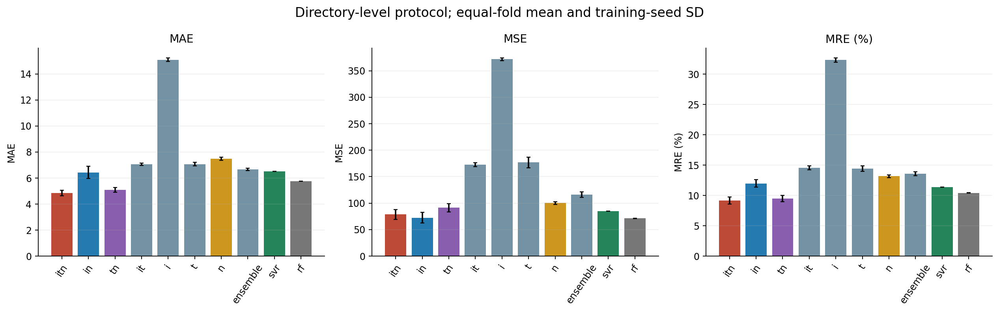

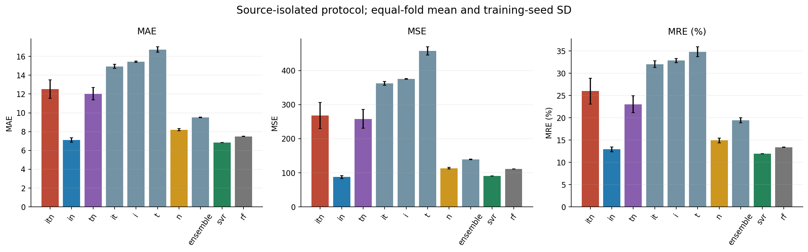

目录级：三分支MAE/MRE最低，随机森林MSE最低。来源隔离：SVR的MAE/MRE最低，图像＋数值的MSE最低。图像＋数值相对数值DNN的来源隔离MAE改善13.41%；当前配置中增加文本，三分支相对图像＋数值的MAE增加76.27%。这些结论限于发布的设置，不表示某模态在所有任务中必然有利或有害。

## 结果图表与诊断

**协议敏感性。** 目录级协议中63.76%的测试行有重复来源出现在训练；三分支在这些行MAE为1.78，在未见来源上为10.29。子群难度不同，这属于描述性对照。

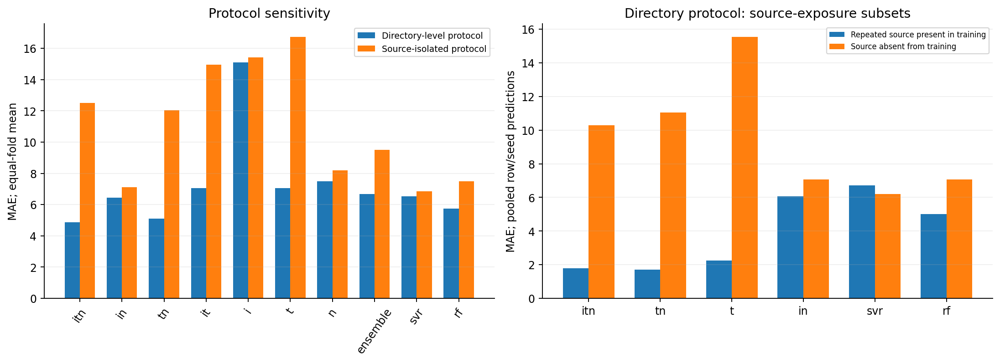

**训练曲线。** 来源隔离时，一些文本相关模型训练误差下降、验证误差回升；最佳权重重放的一项三分支实验训练MAE=1.58、测试=12.58。训练损失是批次更新期间平均，验证损失是轮末模型计算，图中标记最佳轮次。

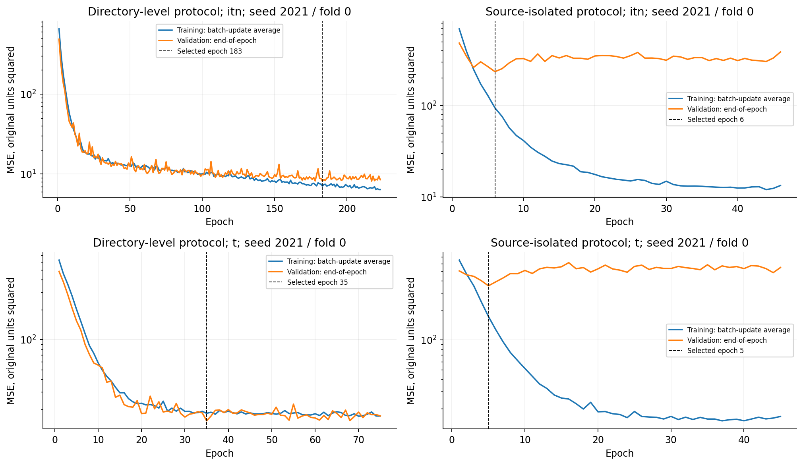

**退化分区。** 三分支倾向高估低退化、低估高退化。真实目标分区仅作事后诊断，预测时不能按未知真值选择模型。

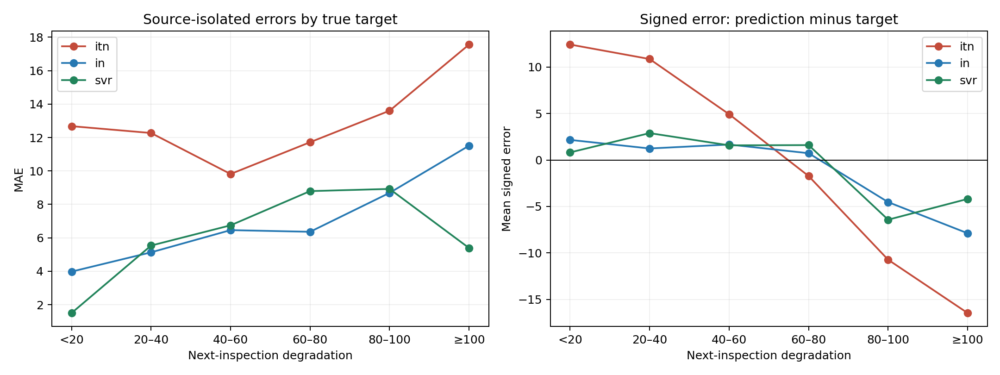

**逐来源误差。** 30个输入历史各显示一次，合并来源内部全部行和五种子的误差，不把复制件视为独立案例。

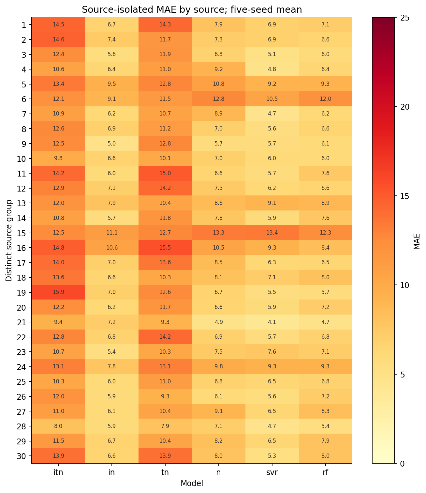

**无信号图像。** 模板占20.12%观测；子群还存在时间、文本与目标差异，不能仅由此断言替换为零矩阵能改善。

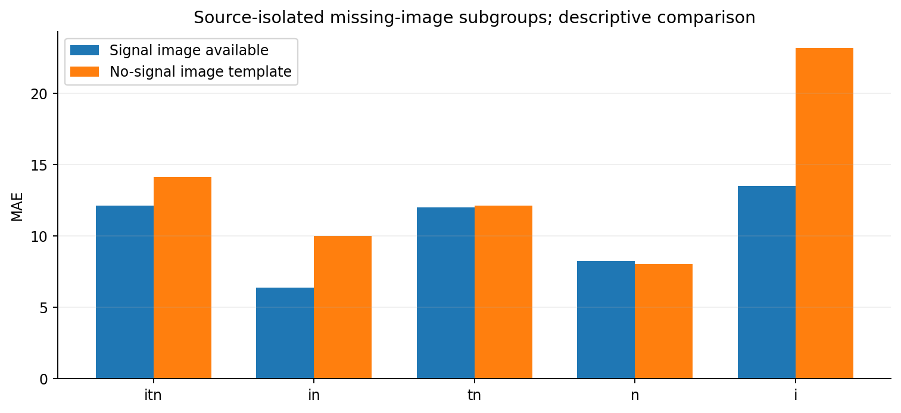

**预测校准与误差分布。** 散点固定使用种子2021；累积分布合并五种子预测，属于相关重复评价。

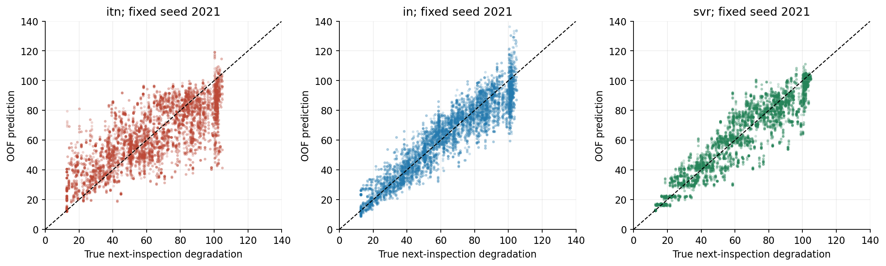

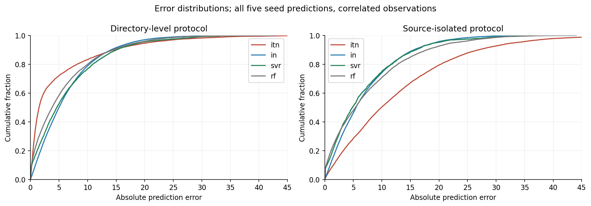

**设备轨迹。** 困难来源19/49、16/46使用固定首种子展示，不选择测试表现最好的种子。同源复制件不算独立案例；完整报告含全部50个目录。

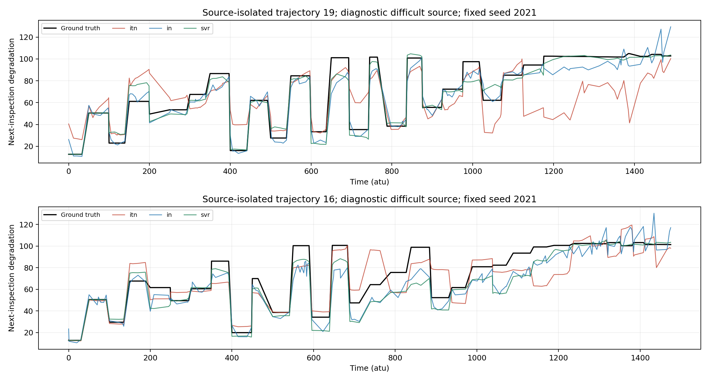

每图提供同名PDF。逐折、逐目录、退化分区和来源指标见 `experiments/` 与Release。种子标准差、折间差异和来源等权误差分别报告；7,626条相关观测不是7,626台独立机器。

## 项目结构与完整成果

```text
mbdnn/                       数据、网络、训练、指标、CLI、报告
configs/                     两套协议及内部验证对照
checks/                      关键完整性与流程检查
scripts/                     数据下载、环境验证、模型测试与分析
assets/                      原版GloVe子集与来源记录
experiments/                 结果表、划分、审计、哈希与分析证据
docs/figures/                12组科学图表，PNG / PDF
docs/                        方法、验证、结果与发布说明
dataset.json                 固定HF数据版本与ZIP哈希
train_and_report.bat          一键检查、训练、测试、报告
README.md / README.en.md      中文 / 英文指南
```

Git排除原始数据、环境、工具、缓存、日志和运行工作目录；全部权重与预测通过Release保留。历史训练源码与指纹一并提供，v1.0.0的命名、文档及可移植性整理不改写已发布指标。

## 方法来源与简短文献对照

分支设计参考Yang、Baraldi、Zio，*A multi-branch deep neural network model for failure prognostics based on multimodal data*，Journal of Manufacturing Systems 59 (2021), 42–50，[DOI](https://doi.org/10.1016/j.jmsy.2021.01.007)。该文三分支MAE为3.20，本项目目录级为4.8567；原始划分及全部优化细节未取得，来源隔离条件也不同，不主张逐数值一致。

## 许可与引用

项目代码：[MIT](LICENSE)。数据保留原作者署名，原发布说明未明确给出数据许可证，详见[数据卡](https://huggingface.co/datasets/GeorgeWJJ/steam-generator-multimodal-prognostics)。GloVe向量遵循上游Public Domain Dedication and License，独立于代码许可；见[第三方说明](THIRD_PARTY_NOTICES.md)。

使用基准请引用原方法/数据论文；使用本项目实现、审计或结果，请标明仓库和Release版本。[CITATION.cff](CITATION.cff)提供项目引用元数据。
